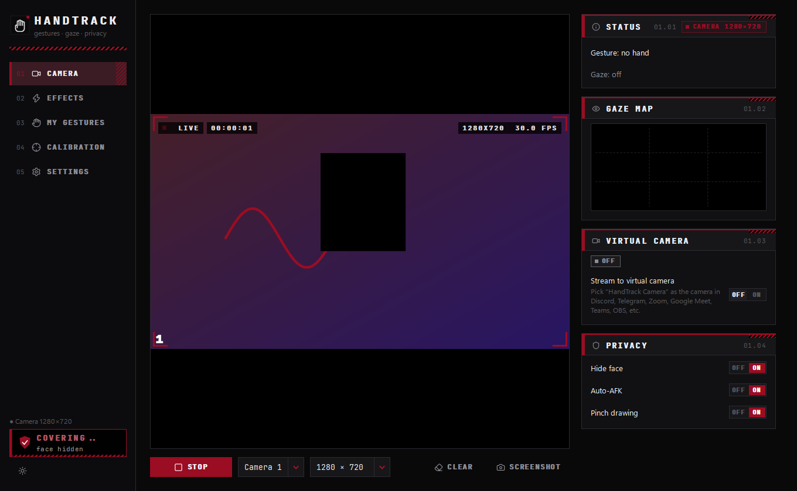

<div align="center">


# HANDTRACK — macOS

**Gestures, gaze, face hiding and drawing in the air, right inside your calls.**
Zoom, Telegram, Discord and Google Meet through OBS Virtual Camera.

*In collaboration with [Claude](https://claude.ai).*

[⬇ Download](../../releases/latest) · [Step-by-step install](HOW-TO-INSTALL.txt) · [Windows](https://github.com/wizzard111/HandTrackWindows) · [Linux](https://github.com/wizzard111/HandTrackLinux)



</div>

## Install

1. [Releases](../../releases/latest) → **handtrack-macos.zip** → double-click it.
2. Double-click **Install HandTrack.command**. macOS warns that it cannot verify the file:
   "System Settings → Privacy & Security → Open Anyway" (macOS 15+)
   or "right-click → Open" (macOS 12–14). The files are already executable.
3. The installer builds HandTrack.app on your Mac (3–6 minutes), puts it in Applications
   and offers to install OBS, whose virtual camera carries the picture into your calls.

Step by step: [HOW-TO-INSTALL.txt](HOW-TO-INSTALL.txt). Uninstall: **Uninstall HandTrack.command**.
Running the installer again only rebuilds or copies what changed.

**Why OBS:** Apple only allows virtual cameras in apps with a paid developer signature
(Camera Extension). So HandTrack sends its frames to the free OBS Virtual Camera; OBS itself
does not have to stay open.

## Update

HandTrack has an updater: **Update HandTrack** in Applications or Launchpad (the installer adds it). It asks
GitHub whether a newer version exists, backs up your settings, calibration and gestures
(`~/Library/Application Support/HandTrack-updater/backups`, the last 3), downloads the release and checks its
SHA-256, and runs its installer, which builds the new HandTrack.app and replaces the old one. Afterwards it checks
that every setting is still there. Installed with an older version without "Update HandTrack"? Double-click
**Update HandTrack.command** in the downloaded folder once (allow it like the installer).
Options: `--check`, `--force`, `--yes`, `--package FILE`.

**Permissions stay after updates.** macOS keeps the camera and Accessibility permissions only for an app signed
with the same certificate every time. The installer (or the first update) makes a free local code-signing
certificate in its own keychain and asks for your Mac password once, to trust it for code signing; every build is
signed with it. If you skip the password, everything still works, but macOS asks for the permissions again after
each update.

**Disk space used by the updater — it does take some room on a Mac:**

| | |
|---|---|
| The updater | one script of about 20 KB, plus the "Update HandTrack" app (a few KB) |
| Build folder | **up to about 1 GB** in `~/Library/Caches/HandTrack-updater`: the source code, a private Python 3.12, the libraries (MediaPipe, OpenCV, Qt) and the last build. They are kept so the next update does not download them again and builds in minutes instead of 5–10. Delete the folder to free the space; the next update then downloads everything again. The uninstaller removes it. |
| Settings backups | a few KB (the last 3) |
| Signing certificate | a few KB (`~/Library/Application Support/reflex-local-signing`, shared with Aerox Lite) |

**Why build on your Mac:** macOS does not block a locally built app as "downloaded from the
internet", and camera permissions are granted normally.

## Repository layout

```
Install HandTrack.command     installer
Uninstall HandTrack.command   uninstaller
Update HandTrack.command      updater ("Update HandTrack" in Applications after installing)
HOW-TO-INSTALL.txt            step-by-step guide
src/handtrack/                the program (same code as on Windows/Linux)
packaging/macos/              HandTrack.app build (PyInstaller, .icns icon)
tests/                        tests
```

## Performance

Measured with [`packaging/benchmark.py`](packaging/benchmark.py): the real app runs each situation for
20 s in a fresh process while the script samples its CPU and memory once a second. To compare
operating systems on equal terms, a generated 1280×720 MJPG video at 30 FPS (the same on every OS; no
hands or faces in view, so detection keeps searching: the costly case) stands in for the webcam.

Machine: AMD Ryzen 5 5600X (6 cores, 12 threads), 16 GB RAM. HandTrack 8.2.0, Python 3.12.
CPU is in % of **one** core, summed over all of the app's threads; divide by 12 for the share of the
whole processor. RAM is the resident set (working set on Windows; includes shared libraries), USS is
memory used by HandTrack alone.

| Situation | Windows 11: CPU | RAM | USS | Linux (Debian 13): CPU | RAM | USS |
|---|---:|---:|---:|---:|---:|---:|
| Window open, camera off | 1.1 % | 203 MB | 135 MB | 0.7 % | 241 MB | 209 MB |
| In the tray, camera off | 0.6 % | 204 MB | 135 MB | — | — | — |
| Camera on | 33 % | 236 MB | 163 MB | 29 % | 288 MB | 252 MB |
| Camera on, window in the tray | 25 % | 235 MB | 162 MB | — | — | — |
| Camera on + Hide face | 32 % | 234 MB | 161 MB | 29 % | 285 MB | 248 MB |
| In a call: Hide face + virtual camera, read by a call app | 38 % | 246 MB | 169 MB | — | — | — |

Medians of 5 runs of 20 s each on an otherwise idle machine (`--repeat 5`). The optional log window
adds a second, tiny process: 0 % CPU and 13 MB on Windows, a terminal running `tail` on Linux and macOS.

With the real webcam (Windows, Lenovo FHD webcam, 1280×720 at ~30 FPS) the numbers depend on what is
in view: 55–85 % of one core (5–7 % of the whole processor), 250–280 MB RAM. Reading the camera
itself costs about 13 % of a core at 1280×720 and 30 % at 1920×1080 (the MJPG decoding in Windows'
DirectShow), so 1280×720, the default, is the economical choice; most call apps send 1280×720 anyway.
The camera starts in about 0.6 s.
Linux was measured under WSL2 (WSLg); "—" means the situation needs a tray or the Windows camera
driver, which WSL lacks. macOS has not been measured.

How it stays light:

- Idle costs almost nothing: no timers repaint the window; the preview, status tags and gaze map
  redraw only when something changes. Before 8.2 an idle window took 11 % of a core. The small
  sidebar animation (about 1 % of a core, 15 FPS) pauses while the window is minimised or in the
  tray, and can be switched off in Settings.
- Detection slows down while nothing is in view (hands 15, faces 10 checks a second) and returns to
  full rate the moment a hand or face appears. Processing runs on its own thread, the neural
  networks asynchronously; the interface never waits for the camera.
- The camera format is set once when it opens (DirectShow rebuilt its capture graph for every
  setting: the first frame came after 2.2 s, now after 0.6 s).
- Every frame is processed once: the AFK screen is rendered once and copied, the preview is
  converted to Qt's native format on the video thread and is not prepared while hidden, stickers
  are blended with integer maths, and the drawing goes straight into the frame.
- No idle thread pools: OpenCV runs single-threaded and numpy's OpenBLAS uses one thread (its
  per-core buffers alone were ~350 MB of private memory).
- Only what is needed is installed: the headless OpenCV, without mediapipe's GUI OpenCV,
  matplotlib and audio packages. The face-hiding sound is played by the operating system, with no
  audio library in the app.

Reproduce: `PYTHONPATH=src python packaging/benchmark.py --repeat 5` (needs `psutil`; add
`--video camera` to use the webcam). Your settings are not touched: every run uses a throwaway data folder.

## License

[MIT](LICENSE). Third-party components: [docs/THIRD_PARTY_NOTICES.md](docs/THIRD_PARTY_NOTICES.md).
